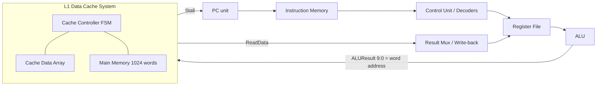
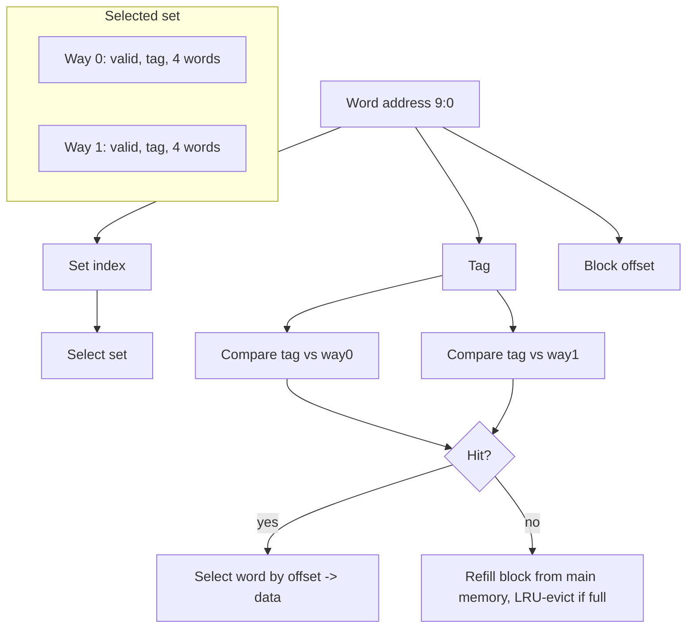

# A 2-Way Set-Associative L1 Data Cache with LRU Replacement for a Single-Cycle RV32I Processor

*A Computer Organization and Architecture project built on an existing open-source RISC-V + direct-mapped cache design.*

---

## 1. Project title
Enhancing an RV32I Processor's L1 Data Cache: From Direct-Mapped to 2-Way Set-Associative with LRU — Design, Simulation, and Comparative Evaluation.

## 2. Abstract
We take an existing open-source single-cycle 32-bit RISC-V (RV32I) processor with an
integrated direct-mapped L1 data cache, reproduce its behavior as a faithful Python
model, identify a specific architectural limitation (conflict misses in the
direct-mapped cache), and implement an improvement: a 2-way set-associative cache with
Least-Recently-Used (LRU) replacement. Keeping cache capacity (512 B), block size
(16 B), write policy (write-through, write-around), and all latencies constant, we
evaluate both designs on identical workloads. On a conflict-heavy workload the enhanced
cache raises the hit rate from 0% to 93.75% and reduces execution cycles from 160 to 40
(a 4× speedup). On workloads without set contention the two designs are identical, and on
a three-way conflict workload the 2-way cache does not help — results we report honestly.

## 3. Introduction
A cache bridges the speed gap between a fast CPU and slow main memory by holding recently
used blocks close to the processor. The *placement policy* decides where a memory block
may live in the cache. A **direct-mapped** cache gives each block exactly one possible
line; it is simple and fast but suffers **conflict misses** when several active blocks
map to the same line. **Set-associative** caches give each block a small set of candidate
lines, trading a little hardware for fewer conflict misses. This project studies that
trade-off concretely on a real RV32I design.

## 4. Problem statement
In the existing direct-mapped L1 data cache, the set index is `addr[6:2]`, so blocks whose
word addresses differ by a multiple of 128 (32 sets × 4 words) are forced into the *same*
line. When a program alternates between two such blocks, each access evicts the other,
producing a conflict miss on **every** access even though the rest of the cache is empty.
The problem: *how much does this hurt, and can a modest increase in associativity fix it
without changing cache size or block size?*

## 5. Motivation
Conflict misses are a well-known weakness of direct-mapped caches and a standard COA topic.
The upstream design is small enough to understand fully yet real enough to measure, which
makes it an ideal base for demonstrating the associativity/LRU trade-off with actual
numbers rather than textbook assertions.

## 6. Objectives
1. Faithfully reproduce the upstream direct-mapped cache behavior and establish a validated baseline.
2. Demonstrate, with measured data, that conflict misses occur under a suitable access pattern.
3. Implement a 2-way set-associative cache with LRU, holding all other parameters constant.
4. Verify correctness with unit and regression tests (Tests A–G).
5. Compare both designs fairly across sequential, repeated, and conflict workloads.
6. Quantify hit rate, misses, stall cycles, total cycles, CPI, and speedup, and interpret them.

## 7. Existing system
A single-cycle RV32I processor (`RTL/RISC-V/`) with an integrated L1 data cache
(`RTL/Cache Memory System/`), written in Verilog with a SystemVerilog testbench. The cache
is **(512, 16, 1)**: 512-byte capacity, 16-byte blocks, direct-mapped (32 blocks). Memory is
word-addressable via a 10-bit word address. Only data memory is cached; instruction memory
is not. Write policy is write-through + write-around; main-memory access costs 4 cycles.
(Full file-by-file breakdown in `docs/ASSESSMENT.md`.)

## 8. Identified limitation
Direct mapping (`index = addr[6:2]`) forces blocks that are 128 words apart into the same
line. Measured on our conflict workload (alternating words 0 and 128, both set 0), the
baseline achieves a **0% hit rate**: 32 accesses → 32 misses, 31 evictions, 160 cycles.
This is the conflict-miss limitation, demonstrated rather than asserted.

## 9. Proposed enhancement
A **2-way set-associative** L1 data cache with **LRU** replacement. Same capacity (512 B),
same block size (16 B), 32 blocks arranged as **16 sets × 2 ways**. The index shrinks to
4 bits and the tag grows to 4 bits; the field widths are *derived from geometry* in one
place (`config.py`), never hard-coded twice. Each set now holds two blocks, so two blocks
that previously thrashed can both stay resident.

## 10. System architecture

The processor is single-cycle; the only multi-cycle behavior is the memory system
asserting `Stall`, which freezes the PC for the 4-cycle main-memory penalty.

## 11. Block diagram (cache)

*(Baseline is the same picture with a single way per set.)*

## 12. CPU components and their roles
| Component | Implemented? | Role |
|---|---|---|
| Program counter | Yes (`PCunit.v`) | Holds/updates instruction address; stalls on cache miss |
| Instruction memory | Yes | Supplies instructions from `riscvtest.txt` |
| Register file | Yes | 32 × 32-bit general registers |
| ALU | Yes (`ALUunit.v`) | add, sub, and, or, slt |
| Control unit | Yes (`Control_Unit.v`) | Decodes opcode/funct into control signals |
| Immediate/sign-extend | Yes | Builds I/S/B/J immediates |
| L1 data cache + controller | Yes (`Cache Memory System/`) | Caches data memory; our enhancement target |
| Main memory | Yes (modeled) | 1024 words, 4-cycle access |
| I/O subsystem | **No** (conceptual only) | Not present in the design |

## 13. Register organization
32 architectural registers `x0..x31`, each 32 bits. `x0` is architecturally zero (our model
enforces this; the upstream relies on the program writing 0 to `x0`). Reads are
combinational; writes occur on the clock edge when `RegWrite` is asserted.

## 14. ALU and control unit
The ALU selects an operation from `ALUControl` (3 bits): `000` add, `001` sub, `010` and,
`011` or, `101` slt; it also outputs a `Zero` flag for branches. The control unit splits
into a main decoder (opcode → `RegWrite`, `MemWrite`, `ALUSrc`, `ResultSrc`, `ImmSrc`,
`Branch`, `Jump`, `ALUOp`) and an ALU decoder (`ALUOp`+funct → `ALUControl`).

## 15. Memory organization and hierarchy
Two-level data hierarchy: **L1 data cache** (512 B, 16-byte blocks) backed by **main memory**
(1024 words). Instruction memory is separate and uncached (Harvard-style split). A hit is
served from L1 with no stall; a miss fetches a full 4-word block from main memory with a
4-cycle penalty.

## 16. System buses and data movement
- Address bus to the data memory system: `ALUResult[9:0]` (word address).
- Write-data bus: register `rs2` value (`RD2`) for stores.
- Read-data bus: `ReadData` back to the write-back mux.
- Control lines: `MemRead`, `MemWrite`, and `Stall` (cache → PC).

## 17. I/O organization
The design has **no I/O subsystem**; it is a compute-plus-memory core. We do not claim any
memory-mapped or interrupt-driven I/O. (Stated explicitly to avoid overclaiming.)

## 18. Instruction format and addressing modes
Implemented RV32I subset and formats:
| Type | Example | Format | Addressing mode |
|---|---|---|---|
| I (ALU) | `addi x1,x0,1` | imm[11:0], rs1, funct3, rd, op | Immediate |
| I (load) | `lw x8,0(x0)` | imm[11:0], rs1, funct3, rd, op | Base + displacement |
| S (store) | `sw x4,0(x0)` | imm[11:5], rs2, rs1, funct3, imm[4:0], op | Base + displacement |
| R | `add x1,x2,x3` | funct7, rs2, rs1, funct3, rd, op | Register |
| B | `beq x1,x2,off` | imm split, rs2, rs1, funct3, imm, op | PC-relative |
| J | `jal x1,off` | imm split, rd, op | PC-relative |

## 19. Instruction cycle
Fetch → Decode → Execute (ALU) → Memory (lw/sw via cache) → Write-back. One cycle per
instruction, extended by the 4-cycle penalty whenever the cache goes to main memory.

## 20. Register-transfer notation (RTN)
- Fetch: `IR ← IMEM[PC];  PCnext ← PC + 4`
- `addi rd,rs1,imm`: `R[rd] ← R[rs1] + sext(imm)`
- `lw rd,imm(rs1)`: `addr ← R[rs1] + sext(imm);  R[rd] ← DCACHE[addr]`
- `sw rs2,imm(rs1)`: `addr ← R[rs1] + sext(imm);  MEM[addr] ← R[rs2]` *(write-through)*; if hit, `CACHE[addr] ← R[rs2]`
- `beq rs1,rs2,off`: `PC ← (R[rs1]=R[rs2]) ? PC+off : PC+4`

## 21. Cache address decomposition
Word address = 10 bits. Fields derived from geometry:
| Design | Tag | Index | Offset | Sets × Ways |
|---|---|---|---|---|
| Baseline (direct-mapped) | `[9:7]` (3 b) | `[6:2]` (5 b) | `[1:0]` (2 b) | 32 × 1 |
| Enhanced (2-way) | `[9:6]` (4 b) | `[5:2]` (4 b) | `[1:0]` (2 b) | 16 × 2 |

## 22. Cache lookup and miss-handling algorithms
```
load(addr):
    s, t, off = index(addr), tag(addr), offset(addr)
    for each way in set[s]:
        if way.valid and way.tag == t:        # HIT
            touch_LRU(s, way); return way.data[off]
    # MISS
    victim = first invalid way in set[s], else LRU way
    if victim.valid: evictions += 1
    victim.data = main_memory.read_block(addr); victim.valid = True; victim.tag = t
    touch_LRU(s, victim); stall += 4
    return victim.data[off]

store(addr, v):            # write-through + write-around
    main_memory[addr] = v; stall += 4
    if tag present in set[s]:  # write hit -> also update cached word
        cached_word[off] = v; touch_LRU
    # write miss -> do NOT allocate (write-around)
```

## 23. LRU replacement algorithm
For a 2-way set, one bit per set records the most-recently-used (MRU) way; the LRU victim
is the *other* way. Every hit or fill marks its way MRU. On a fill into a full set, the way
that is **not** MRU is evicted. This is exact for 2-way (true LRU) and trivial to defend.

## 24. Implementation details
A single `Cache` class (`sim/cache.py`) implements both designs; `CacheConfig.associativity`
(1 or 2) selects the geometry, and the index/tag split is computed from it. The CPU
(`sim/cpu.py`) decodes exactly the upstream RV32I subset and routes `lw`/`sw` through the
cache. All geometry, policy, and latency constants live in `sim/config.py` (one source of
truth). Stats and cycle accounting are in `sim/stats.py`; traces in `sim/trace.py`.

## 25. Experimental methodology
Both configs run on the **same** harness (`sim/runner.py`): same CPU, memory, policy,
latencies, and access sequences; only associativity differs. Workloads
(`sim/workloads/patterns.py`), with addresses justified from the real mapping:
- **sequential**: 64 contiguous word loads (spatial locality).
- **repeated**: 8-word working set, 8 passes (temporal locality).
- **conflict**: alternate words 0 and 128 (both set 0) ×16.
- **conflict3**: cycle words 0, 128, 256 (all set 0) ×16 — honest hard case.
Plus the validated **original** 19-instruction program.

## 26. Results and comparison tables
Measured (`results/comparison.csv`):

| Workload | Base hit% | Enh hit% | Base miss | Enh miss | Miss ↓% | Base cyc | Enh cyc | Speedup |
|---|---|---|---|---|---|---|---|---|
| original | 45.45 | 45.45 | 6 | 6 | 0.0 | 47 | 47 | 1.00× |
| sequential | 75.00 | 75.00 | 16 | 16 | 0.0 | 128 | 128 | 1.00× |
| repeated | 96.88 | 96.88 | 2 | 2 | 0.0 | 72 | 72 | 1.00× |
| conflict | 0.00 | 93.75 | 32 | 2 | 93.75 | 160 | 40 | **4.00×** |
| conflict3 | 0.00 | 0.00 | 48 | 48 | 0.0 | 240 | 240 | 1.00× |

## 27. Graphs and interpretation
Generated from measured data (`plots/`): `hit_rate.png`, `miss_count.png`,
`stall_cycles.png`, `total_cycles.png`.
- Hit rate: identical bars for original/sequential/repeated; a large gap only on `conflict`.
- Misses / stalls / cycles: baseline towers over enhanced on `conflict`; equal elsewhere.
Interpretation: associativity helps **only** when the bottleneck is set contention. Spatial
and temporal locality are already captured by both designs, so they are unchanged.

## 28. Objective-by-objective evaluation
1. Baseline reproduced and validated (regs + memory + testbench criterion). ✔
2. Conflict misses demonstrated (conflict workload, 0% baseline hit rate). ✔
3. 2-way + LRU implemented with constant capacity/block/policy. ✔
4. Tests A–G pass (14 tests). ✔
5. Fair comparison across all workloads on one code path. ✔
6. Metrics quantified and interpreted, including an honest non-improvement case. ✔

## 29. Limitations
- The Python model is a **behavioral reproduction** of the Verilog, validated against the
  original program — not the gate-level RTL; "cycles" are simulated architectural cycles.
- 2-way helps conflicts between **two** hot blocks; with three (`conflict3`) it still thrashes.
- The shipped `riscvtest.txt` is truncated relative to the README/testbench (see §4 of ASSESSMENT); we validate against the README program.
- Small address space (10-bit) and single-cycle core; no pipeline, no I/O.

## 30. Conclusion
Increasing associativity from direct-mapped to 2-way with LRU, at equal capacity and block
size, eliminated conflict-miss thrashing in the targeted workload (0%→93.75% hit rate,
4× fewer cycles) while leaving contention-free workloads unchanged. The enhancement is a
textbook win delivered with measured evidence, and its limits are shown honestly.

## 31. Future improvements
- 4-way or 8-way associativity; victim cache; pseudo-LRU for higher associativity.
- Write-back + write-allocate policy comparison.
- A second cache level (L2) and larger address space.
- Port the enhanced policy back into synthesizable Verilog and validate under a simulator.

## 32. References and attribution
See `docs/CONTRIBUTION.md` for the upstream repository, authorship, license, and a precise
original-vs-ours changelog. Metric definitions and the associativity/LRU concepts follow
standard COA treatments (e.g. Patterson & Hennessy, *Computer Organization and Design*).
